<div align="center">


</div>

<table>
<tr>
<td width="50%" valign="top">

```yaml
# ~/.config/i-am-not-you.yml
alias: I-am-not-you
codinome: "Am I you?"
classe: Automation & Data
foco: [bots, automações, dashboards, APIs]
infra: [Active Directory, redes, servidores]
modo_atual: "segurança ofensiva 🔐"
setup: [VS Code, terminal escuro, café ☕]
anime_mode: true
```

</td>
<td width="50%" valign="top">

```bash
└─$ cat missoes.log
```

- [x] Bots que alimentam planilhas sozinhos
- [x] Dashboards em tempo real
- [x] Scripts que automatizam o navegador
- [x] Active Directory e suporte remoto
- [ ] Docker + CI/CD
- [ ] Homelab com servidores virtuais
- [ ] Primeira máquina no Hack The Box

</td>
</tr>
</table>

<div align="center">



<table>
<tr>
<td align="center" width="150"><b>💻 Linguagens</b></td>
<td>
     
</td>
</tr>
<tr>
<td align="center" width="150"><b>🤖 Automação</b></td>
<td>
    
</td>
</tr>
<tr>
<td align="center" width="150"><b>⚙️ DevOps</b></td>
<td>
     
</td>
</tr>
<tr>
<td align="center" width="150"><b>🖥️ Infra & TI</b></td>
<td>
     
</td>
</tr>
</table>




        

<br/><br/>

> *他人になるな。自分であれ。* — não seja outro. seja você.


</div>
