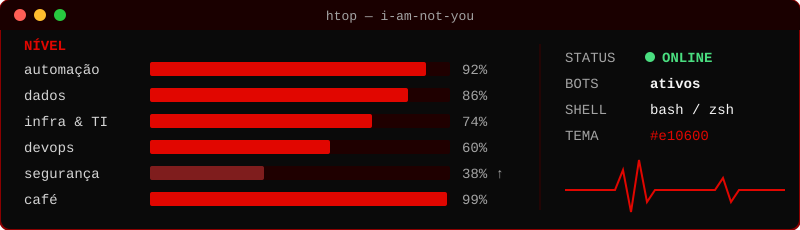
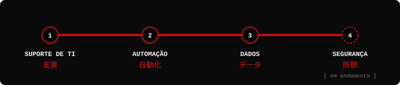

<div align="center">







</div>

<table>
<tr>
<td width="50%" valign="top">

```yaml
# ~/.config/i-am-not-you.yml
alias: I-am-not-you
codinome: "Am I you?"
classe: Automation & Data
foco: [bots, automações, dashboards, APIs]
infra: [Active Directory, redes, servidores]
modo_atual: "segurança ofensiva 🔐"
setup: [VS Code, terminal escuro, café ☕]
anime_mode: true
```

</td>
<td width="50%" valign="top">

```bash
└─$ cat missoes.log
```

- [x] Bots que alimentam planilhas sozinhos
- [x] Dashboards em tempo real
- [x] Scripts que automatizam o navegador
- [x] Active Directory e suporte remoto
- [ ] Docker + CI/CD
- [ ] Homelab com servidores virtuais
- [ ] Primeira máquina no Hack The Box

</td>
</tr>
</table>

<div align="center">


</div>

<div align="center">


<table>
<tr>
<td align="center" width="150"><b>💻 Linguagens</b></td>
<td>
     
</td>
</tr>
<tr>
<td align="center" width="150"><b>🤖 Automação</b></td>
<td>
    
</td>
</tr>
<tr>
<td align="center" width="150"><b>⚙️ DevOps</b></td>
<td>
     
</td>
</tr>
<tr>
<td align="center" width="150"><b>🖥️ Infra & TI</b></td>
<td>
     
</td>
</tr>
</table>




</div>

<table>
<tr>
<td width="50%" valign="top">

**🤖 Bot de sincronização**<br/>
<sub><code>Python · Sheets API</code></sub><br/>
Coleta dados de sistemas web e alimenta planilhas sozinho, 24/7<br/>
<sub>🔒 privado</sub>

</td>
<td width="50%" valign="top">

**📊 Dashboards de produtividade**<br/>
<sub><code>JavaScript · HTML</code></sub><br/>
Painéis visuais com indicadores atualizando em tempo real<br/>
<sub>🔒 privado</sub>

</td>
</tr>
<tr>
<td width="50%" valign="top">

**🗄️ Sistema de inventário**<br/>
<sub><code>JavaScript</code></sub><br/>
Controle de equipamentos: entrada, saída e status<br/>
<sub>🔒 privado</sub>

</td>
<td width="50%" valign="top">

**🎫 Central de chamados de TI**<br/>
<sub><code>TypeScript</code></sub><br/>
Abertura e acompanhamento de chamados de ativos<br/>
<sub>🔒 privado</sub>

</td>
</tr>
<tr>
<td width="50%" valign="top">

**🧩 Userscripts & extensões**<br/>
<sub><code>JS · Tampermonkey</code></sub><br/>
Automatizam tarefas repetitivas direto no navegador<br/>
<sub>🔒 privado</sub>

</td>
<td width="50%" valign="top">

**☁️ Backend em nuvem**<br/>
<sub><code>Render · APIs</code></sub><br/>
Serviço no ar que alimenta os dashboards<br/>
<sub>🔒 privado</sub>

</td>
</tr>
</table>

<div align="center">












<br/><br/>

> *他人になるな。自分であれ。* — não seja outro. seja você.


</div>
